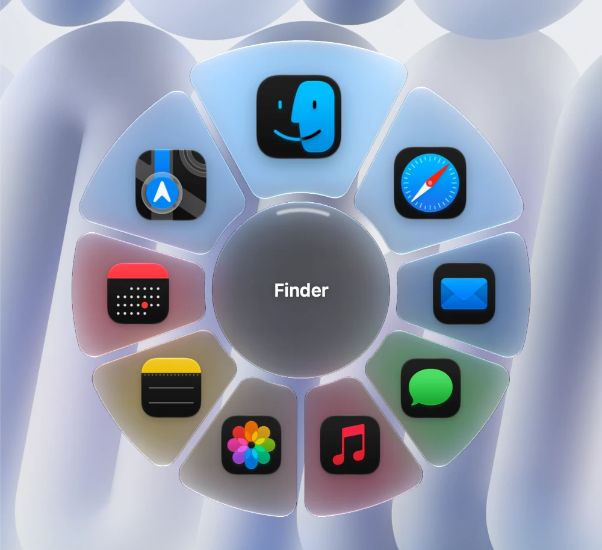

# Rondo

Круговой переключатель приложений для macOS вместо стандартного Cmd+Tab. Зажимаешь Cmd+Tab — появляется круг из плиток приложений, Tab и мышь двигают выбор, отпускаешь Cmd — переключаешься. На macOS 26 и новее круг рисуется стеклом Liquid Glass.

<p align="center">
  
</p>

## Установка

1. Скачай `Rondo-1.0.dmg` со страницы [Releases](../../releases) и перетащи Rondo в «Программы».
2. Приложение не нотаризовано. При первом запуске macOS предупредит, что разработчик не проверен: открой его правым кликом → «Открыть» или разреши в «Системные настройки → Конфиденциальность и безопасность».
3. Разреши Rondo доступ в «Конфиденциальность и безопасность → Универсальный доступ», иначе оно не сможет перехватывать Cmd+Tab.

Требуется macOS 13 или новее. Готовая сборка только под Apple Silicon (arm64).

## Настройки

Иконка в строке меню → «Настройки…». Вид круга (стекло, размер, плитки, подписи), анимации и поведение (замена системного Cmd+Tab, выбор мышью, запуск при входе).

## Сборка из исходников

Нужны Xcode или Command Line Tools со Swift.

```bash
make          # собрать build/Rondo.app
make run      # собрать и запустить
make test     # запустить тесты логики
make dmg      # собрать установочный образ build/Rondo-1.0.dmg
```

Приложение подписывается сертификатом «RingTab Dev», если он есть в связке ключей, иначе ad-hoc подписью. Свой сертификат можно задать через `SIGN` в `Makefile`.

## Структура

- `src/` — исходники на Swift (`main.swift`, `overlay.swift`, `glass.swift`, `settingsui.swift` и др.)
- `res/` — иконка и логотип
- `tools/` — генерация логотипа, фона и скрипт сборки DMG

## Лицензия

[MIT](LICENSE)
